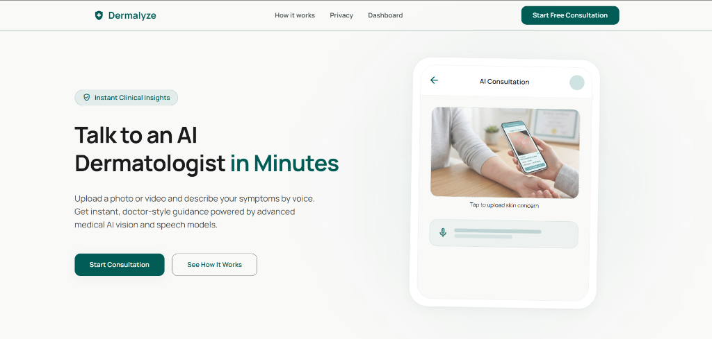
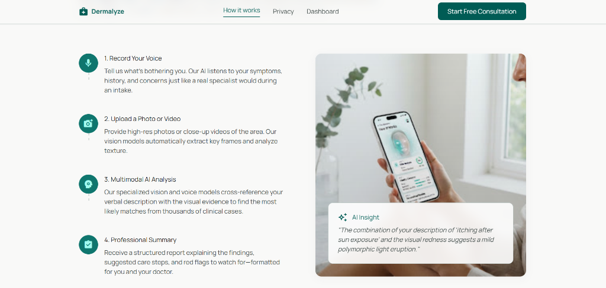
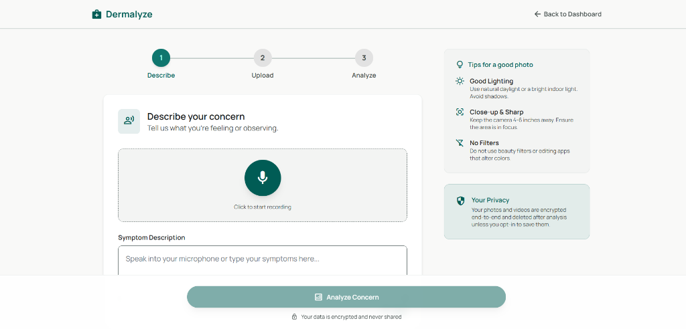
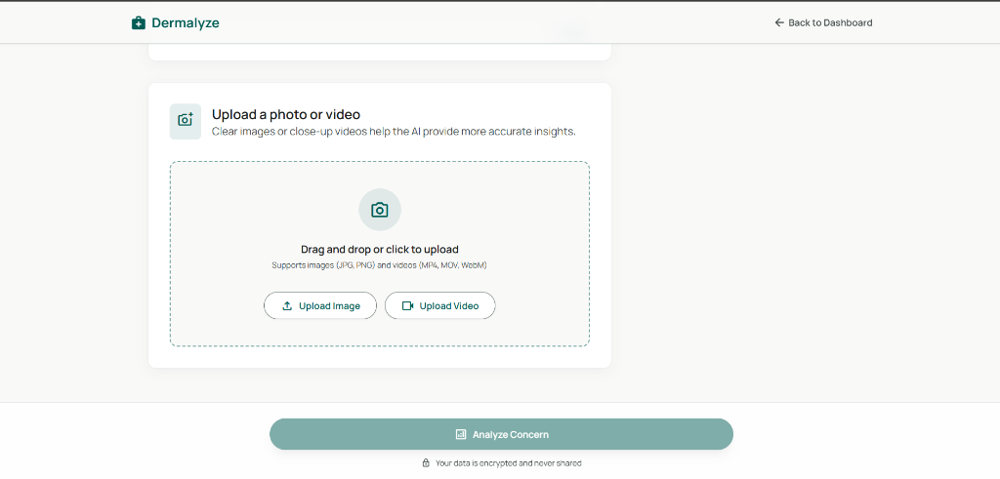
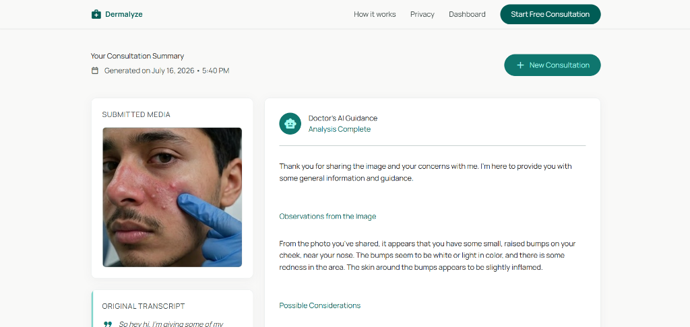
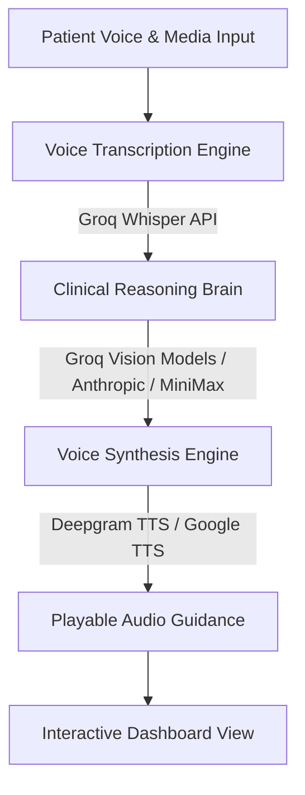

# Dermalyze — AI Skin Specialist & Consultation Assistant

Dermalyze is a state-of-the-art, multimodal AI-powered consultation assistant designed to provide instant, empathetic, and informative skin health guidance. In regions where dermatologist appointments require weeks of waiting, Dermalyze acts as a digital triage system, translating patient descriptions and analyzing close-up skin images/video frames to generate structured, clinical-grade observations and realistic audio feedback.

> [!IMPORTANT]
> **Medical Disclaimer:** Dermalyze provides general informational guidance only. It is not a clinical diagnostic tool, does not prescribe medication, and must not replace professional consultation or treatment from a licensed dermatologist or medical practitioner.

---

## 📸 Application Interface

### 1. Landing & Triage Portal
Discover the mission behind Dermalyze and explore how virtual consultation helps reduce anxiety and wait times.


### 2. Streamlined Multi-Step Process
Patients are guided through a structured 3-step consultation interface.


### 3. Consultation Setup
Patients record description of their symptoms naturally by voice.


Patients upload high-quality close-up photos or videos of the skin concern.


### 4. Interactive Report Dashboard
Get clear, structured doctor guidance alongside the submitted media, original transcript, and generated audio response.


---

## 🎥 Application Demo Video

Click the preview image below to watch the interactive demonstration of the Dermalyze platform on Google Drive:

[](https://drive.google.com/file/d/1Ck69S0Y9E2ZM9FH8vWqrtSnNQpLzhnan/view?usp=drive_link)

---

## 🛠️ System Architecture & Workflow

Dermalyze separates concerns between frontend assets and the python backend engine:



1. **Speech-to-Text Transcription (`backend/src/voice_of_the_patient.py`)**: Captures patient voice inputs using Python microphone recording tools (`pyaudio`, `speech_recognition`) and leverages the high-speed **Groq Whisper API** (`whisper-large-v3`) for accurate clinical descriptions.
2. **Multimodal Analysis (`backend/src/brain_of_the_doctor_groq.py`)**: Evaluates close-up photos or video frames coupled with the transcribed text using Groq's Vision Models (e.g., Llama 3 Vision). Generates detailed observations, possibilities to consider, and recommended next steps.
3. **Realistic Voice Output (`backend/src/voice_of_the_doctor.py`)**: Converts generated clinical guidance into a comforting, spoken MP3 format using the **Deepgram Text-to-Speech API** (`aura-2-thalia-en`). Automatically falls back to Google Text-to-Speech (`gTTS`) if no Deepgram API key is present.
4. **FastAPI Web Service (`backend/app.py`)**: Implements backend database controls saving history locally to `consultations.json`, exposes standard endpoints `/analyze`, `/api/consultations`, and serves modern templates from the peer `frontend` directory.

---

## 📂 Project Structure

```text
Dermalyze/
├── README.md                   # Project documentation & screenshots
├── .gitignore                  # Excluded local caches, secrets, and temp media
├── assets/                     # Global static assets
│   └── screenshots/            # UI screenshots shown in the README
├── frontend/                   # Frontend codebase
│   ├── landing.html            # Main splash page
│   ├── how-it-works.html       # Visual process description
│   ├── consultation.html       # Multiphase session wizard
│   ├── results.html            # Report summary & audio playback view
│   ├── dashboard.html          # History cards list
│   ├── privacy.html            # Patient data protection policy
│   └── index.html              # Custom dashboard layout
└── backend/                    # Backend codebase
    ├── app.py                  # FastAPI web server entry point & API endpoints
    ├── main.py                 # Alternative Gradio prototyping GUI
    ├── pyproject.toml          # Python project metadata & requirements
    ├── uv.lock                 # Locked dependencies (managed by uv)
    ├── .env                    # Local credentials (API keys)
    └── src/                    # Core system execution pipeline package
        ├── __init__.py
        ├── voice_of_the_patient.py # Audio recording and Whisper transcription logic
        ├── brain_of_the_doctor_groq.py # Groq Llama Vision reasoning logic
        ├── brain_of_the_doctor.py  # Alternative Anthropic/MiniMax compatibility module
        ├── voice_of_the_doctor.py  # Deepgram & gTTS audio generation
        └── free_text_to_speech.py  # Audio testing helper script
```

---

## 🚀 Installation & Setup

### 1. Install System Dependencies
Make sure `FFmpeg` (for audio processing) and `PortAudio` (for microphone input) are installed on your machine.

* **macOS**:
  ```bash
  brew install ffmpeg portaudio
  ```
* **Windows** (using PowerShell as Administrator):
  ```powershell
  choco install ffmpeg portaudio
  ```
* **Linux (Debian/Ubuntu)**:
  ```bash
  sudo apt update && sudo apt install -y ffmpeg portaudio19-dev python3-dev build-essential
  ```

### 2. Install Project Dependencies
We recommend using `uv` for fast virtual environment setup inside the backend folder:
```bash
# Navigate to backend and install dependencies
cd backend
uv sync
```
*Note: If you do not have `uv` installed, you can set it up via `pip install uv` or run standard `python -m venv .venv` and activate it.*

### 3. Setup Environment Variables
Create a `.env` file in the `backend/` folder:
```env
GROQ_API_KEY=your_groq_api_key_here
DEEPGRAM_API_KEY=your_deepgram_api_key_here

# Optional overrides
WHISPER_MODEL=whisper-large-v3
GROQ_MODEL=meta-llama/llama-4-scout-17b-16e-instruct
DEEPGRAM_TTS_MODEL=aura-2-thalia-en
```

---

## 🏃 Running the Application

To start the FastAPI web dashboard, run the following from the root directory:
```bash
# Start the FastAPI web service
uv run --cwd backend python app.py
```
Open your browser and navigate to **`http://127.0.0.1:7860`**.

To launch the alternative Gradio development prototype:
```bash
# Start Gradio interface
uv run --cwd backend python main.py
```
This launches a quick testing interface on **`http://127.0.0.1:7860`** (or next available port).

---

## 🔒 Security & Data Retention
* Patient photos, audio inputs, and video uploads are stored locally in the temporary `temp_media/` folder.
* Real-time analysis deletes temporary input WAV files upon completion.
* To protect patient confidentiality, avoid committing `.env` and `consultations.json` to public repositories.
